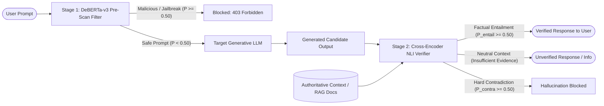

# GuardShield AI

[](https://opensource.org/licenses/Apache-2.0)
[](https://www.python.org/downloads/)
[](https://pytorch.org/)
[](https://huggingface.co/)
[](https://colab.research.google.com/github/Shourya3113/GuardShield-AI/blob/main/GuardShield_AI_Live_Colab_Suite.ipynb)

> **Real-Time Dual-Stage Pre-Scan Defense and Fact Grounding Architecture for Large Language Models**  
> *Capstone Research Project | Group 50 | Academic Year 2026*

---

## 📌 Executive Summary

Modern Large Language Models (LLMs) deployed in production environments face two critical, compounding vulnerability vectors:
1. **Adversarial Ingress**: Prompt injections, role-play jailbreaks, and obfuscated exploits that bypass system prompts to compromise model alignment.
2. **Hallucinatory Egress**: Fabricated assertions, unsupported extrapolations, and factual inconsistencies generated during open-ended decoding.

**GuardShield AI** provides a synchronous dual-stage defense pipeline combining:
- **Stage 1 (Pre-Scan Filter)**: A lightweight, fine-tuned transformer classifier (`microsoft/deberta-v3-small`: 44.3M backbone, 142.6M total parameters including the 128k SentencePiece vocabulary) that inspects ingress prompts in **~26.53 ms (p50)** with sliding-window chunking, blocking injections, jailbreaks, and length-padded attacks before they consume expensive downstream LLM decoding passes.
- **Stage 2 (Post-Generation Fact Grounding)**: A cross-encoder Natural Language Inference (NLI) verifier (`cross-encoder/nli-deberta-v3-small`) that performs premise-hypothesis entailment verification (**~22.96 ms p50**) to validate LLM assertions against authoritative retrieval context in RAG architectures.
- **Measured End-to-End Pipeline Latency**: Sequential Stage 1 + Stage 2 execution overhead measures **41.52 ms (p50)** / **44.80 ms (mean)** across 100 sequential queries on CUDA, logged per-sample in [`raw_eval_pipeline_e2e.json`](docs/01%20Reports/raw_eval_pipeline_e2e.json).



---

<!-- BEGIN GENERATED RESULTS (scripts/generate_readme_tables.py) -->
## 📊 V3 Mega Research Benchmark Evaluation (5,948 Curated Samples)

GuardShield AI has been empirically evaluated across **7 published academic and industry benchmark datasets**:
- **Security & Adversarial Benchmarks (5,148 samples)**:
  - *In-Distribution (4,648 samples)*: Partitioned into 3,253 Train, 697 Validation, and 698 Test samples across Stanford Online Safety (SPML), Jayavibhav Injection Suite, Deepset Prompt Injections, and TruthfulQA benign queries.
  - *Out-of-Distribution Zero-Shot (500 samples)*: 76 human-written ChatGPT jailbreaks + 174 synthetic template-shift injections + 250 held-out benign queries.
- **Factuality & Hallucination Grounding Benchmarks (800 unique pairs)**:
  - 400 claim-evidence pairs from **FEVER (NAACL 2018)**.
  - 400 grounded/hallucinated QA pairs from **HaluEval (EMNLP 2023)**.

### Empirical Evaluation Summary

| Defense Component | Evaluation Dataset / Split | Sample Size ($N$) | Accuracy (%) | Precision (%) | Recall (%) | F1-Score | FPR (%) | Median Latency (ms) |
| :--- | :--- | :---: | :---: | :---: | :---: | :---: | :---: | :---: |
| **Stage 1: Pre-Scan** | **In-Distribution Test Split** | **698** | **99.00%** | **99.43%** | **98.59%** | **0.9901** | **0.58%** | **26.53 ms** |
| **Stage 1: Pre-Scan** | **Out-of-Distribution Zero-Shot** | **500** | **98.20%** | **99.18%** | **97.20%** | **0.9818** | **0.80%** | **26.13 ms** |
| **Stage 2: Fact Verifier** | **Multi-Source Fact Grounding (FEVER + HaluEval)** | **800** | **73.00%** | **76.29%** | **66.75%** | **0.7120** | **20.75%** | **22.96 ms** |
| **Dual-Stage Pipeline** | **Sequential Pipeline Overhead (5-Repeat)** | **500** | — | — | — | — | — | **41.52 ms** (IQR: 11.95 ms) |

*Stage 1 metrics are pure neural inference with sliding-window chunking (no keyword heuristics). Stage 2 runs `verify_claim` with multi-sentence decomposition: FEVER 86.25% accuracy / 0.9496 AUROC, HaluEval QA 59.75% accuracy / 0.6127 AUROC. Neutral claims without sufficient evidence are reported as `UNVERIFIED_NEUTRAL` rather than as hallucinations. Per-sample predictions, latencies, dataset/weights SHA-256 hashes and git commits are in `docs/01 Reports/raw_eval_*.json`; all Stage 1 numbers on this page come from weights `cd1e81a29c1eb942`.*

#### Stage 2 Disaggregated Fact Grounding Breakdown (FEVER vs. HaluEval)

| Fact Grounding Benchmark Split | Sample Size ($N$) | Accuracy (%) | Contradiction Recall (%) | Precision (%) | FPR (%) | AUROC |
| :--- | :---: | :---: | :---: | :---: | :---: | :---: |
| FEVER (NAACL 2018) | 400 | 86.25% | 88.00% (176/200) | 85.02% | 15.50% (31 false alarms) | 0.9496 |
| HaluEval QA (EMNLP 2023) | 400 | 59.75% | 45.50% (91/200) | 63.64% | 26.00% (52 false alarms) | 0.6127 |
| **Combined Authentic Suite** | 800 | 73.00% | 66.75% (267/400) | 76.29% | 20.75% (83 false alarms) | 0.8131 |

---

### Comparative Baselines: GuardShield vs. TF-IDF & ProtectAI DeBERTa-v3

GuardShield is compared with TF-IDF + Logistic Regression and ProtectAI's `deberta-v3-base-prompt-injection-v2` (184.0M parameters) on identical splits:

| Model Architecture | Total Parameters | In-Distribution Accuracy | In-Distribution Recall | OOD Zero-Shot Accuracy | OOD Zero-Shot Recall | Human DAN Recall | Template Shift Recall | Latency (p50) |
| :--- | :---: | :---: | :---: | :---: | :---: | :---: | :---: | :---: |
| **TF-IDF + Logistic Regression (Baseline)** | Linear (10k n-grams) | 94.41% | 91.55% | 71.60% | 45.60% | 92.11% (70/76) | 25.29% (44/174) | < 1 ms |
| **ProtectAI DeBERTa-v3-base (External SLM)** | 184.0M (Base) | 93.84% | 88.73% | 88.20% | 78.80% | 86.84% (66/76) | 75.29% (131/174) | 65.26 ms |
| **GuardShield DeBERTa-v3 (Ours)** | **142.6M (Small)** | **99.00%** | **98.59%** | **98.20%** | **97.20%** | **90.79% (69/76)** | **100.00% (174/174)** | **26.53 ms** |

**Granular Zero-Shot OOD Breakdown**:
- **Human-written DAN jailbreaks (76 prompts)**: GuardShield 90.79% (69/76), ProtectAI 86.84% (66/76), TF-IDF 92.11% (70/76). These prompts share explicit lexical markers ("jailbroken", "DAN"), which is why TF-IDF does well here.
- **Synthetic template-shift injections (174 prompts, 5 structural templates with slot variations)**: GuardShield 100.00% (174/174), ProtectAI 75.29% (131/174), TF-IDF 25.29% (44/174).
- **All OOD attacks**: GuardShield recall 97.20% (243/250) with a benign false positive rate of 0.80% (2/250).
- **In-distribution attack recall by source**: Deepset Benchmark 93.02% (40/43), Jayavibhav Benchmark (327K Corpus) 98.46% (64/65), Stanford SPML (16K Benchmark) 99.60% (246/247).
- **Statistical rigor**: in-distribution accuracy 99.00% (95% Wilson CI 97.94%–99.51%). Length-matched controls and long-prompt audits are in [`statistical_rigor_and_controls.md`](docs/03%20Research%20and%20Catalogs/statistical_rigor_and_controls.md).

---

### 💬 Multi-Turn Benign Dialogue Robustness Benchmark (N=20 Conversations, 100 Turns)

All 20 conversations (algorithmic follow-ups, ML derivations, networking, Hinglish/Hindi dialogue, creative role-play) are benign, so every flag is a false positive. GuardShield is scored with the proxy's own multi-turn logic (`proxy_server.scan_messages`); ProtectAI scores each turn in isolation:

| Configuration | Turns Flagged (all, $N=100$) | User Turns Flagged ($N=60$) | Assistant Turns Flagged ($N=40$) | Conversations Blocked ($N=20$) |
| :--- | :---: | :---: | :---: | :---: |
| **ProtectAI DeBERTa-v3-base (stateless)** | 7.00% (7/100) | 8.33% (5/60) | 5.00% (2/40) | 20.00% (4/20) |
| **GuardShield AI (no signed history)** | 11.00% (11/100) | 8.33% (5/60) | 15.00% (6/40) | 25.00% (5/20) |
| **GuardShield AI (signed assistant history)** | — | **6.67% (4/60)** | not scanned (signed) | **15.00% (3/20)** |

*Scanning relayed assistant turns with an ingress classifier compounds false alarms. With HMAC-signed assistant history, verified assistant replies are not rescanned while user turns and unsigned or forged assistant turns are always scanned.*

---

### 🛡️ Adaptive Adversarial Robustness & Evasion Defense

Eleven perturbation vectors on balanced cohorts with exact 95% Wilson intervals (details in [`table_adaptive_robustness.md`](docs/01%20Reports/table_adaptive_robustness.md)):

| Perturbation Vector | $N$ (attack / benign) | GuardShield Recall [95% CI] | GuardShield Benign FPR [95% CI] | Fixed 128-Token Truncation Recall | Keyword Blocklist Recall |
| :--- | :---: | :---: | :---: | :---: | :---: |
| 1. Raw Ingress (Baseline) | 100 / 100 | 98.0% [93.0%, 99.5%] | 0.0% [0.0%, 3.7%] | 98.0% | 21.0% |
| 2. Zero-Width Spaces (Invisible Chars) | 100 / 100 | 100.0% [96.3%, 100.0%] | 96.0% [90.2%, 98.4%] | 100.0% | 0.0% |
| 3. Soft-Hyphens (Subword Splitting) | 100 / 100 | 100.0% [96.3%, 100.0%] | 98.0% [93.0%, 99.5%] | 100.0% | 0.0% |
| 4. Leetspeak Obfuscation | 100 / 100 | 100.0% [96.3%, 100.0%] | 98.0% [93.0%, 99.5%] | 100.0% | 0.0% |
| 5. Cyrillic Homoglyphs (Visual Spoof) | 100 / 100 | 99.0% [94.5%, 99.8%] | 86.0% [77.9%, 91.5%] | 99.0% | 1.0% |
| 6. Base64 Cipher Wrapping | 100 / 100 | 100.0% [96.3%, 100.0%] | 98.0% [93.0%, 99.5%] | 100.0% | 0.0% |
| 7. ROT13 Caesar Cipher Wrapping | 100 / 100 | 96.0% [90.2%, 98.4%] | 81.0% [72.2%, 87.5%] | 96.0% | 0.0% |
| 8. Hinglish Code-Mixed Wrapping | 100 / 100 | 100.0% [96.3%, 100.0%] | 59.0% [49.2%, 68.1%] | 100.0% | 21.0% |
| 9. Benign Prefix Padding (>256 Tok) | 100 / 100 | 94.0% [87.5%, 97.2%] | 0.0% [0.0%, 3.7%] | 0.0% | 21.0% |
| 10. Benign Suffix Padding (>256 Tok) | 100 / 100 | 87.0% [79.0%, 92.2%] | 0.0% [0.0%, 3.7%] | 87.0% | 21.0% |
| 11. Sandwich Padding (Evasion Core) | 100 / 100 | 90.0% [82.6%, 94.5%] | 0.0% [0.0%, 3.7%] | 0.0% | 21.0% |

- **Character and cipher obfuscation**: On 7 of the 11 vectors (Zero-Width Spaces (Invisible Chars), Soft-Hyphens (Subword Splitting), Leetspeak Obfuscation, Cyrillic Homoglyphs (Visual Spoof), Base64 Cipher Wrapping, ROT13 Caesar Cipher Wrapping, Hinglish Code-Mixed Wrapping), benign prompts carrying the same perturbation are flagged at a **59.0%–98.0% FPR**. Recall on those rows therefore reflects blanket rejection of non-standard text (token fragmentation, cipher wrappers), not semantic decoding of the payload.
- **Length padding** keeps the semantics clean: fixed 128-token truncation misses attacks once a long benign prefix is prepended, while sliding-window chunking scans every window and takes the maximum risk (see the padding rows above).
- **XSTest (450 prompts)**: false refusal rate on 250 safe homonym prompts is 0.0% [0.0%, 1.5%]; block rate on 200 plainly harmful (non-injection) requests is 0.0% [0.0%, 1.9%]. Stage 1 is a prompt-injection/jailbreak filter, not a harmful-content moderator.
- **Calibration**: `PreScanSecurityFilter` uses raw logits ($T = 1.0$); scalar temperature scaling does not move decisions at the 0.50 threshold.

---

## ⚠️ Known Limitations & Operational Boundaries

1. **Benign-hard, multilingual and multi-turn false positives**:
   - On the 85-probe benign-hard suite, GuardShield flags 16.92% (11/65) of benign prompts (ProtectAI: 18.46% (12/65)) while catching 100.00% (20/20) of its attacks. Highest benign FPR categories: Hinglish Benign 40.00% (4/10); Hindi Benign 40.00% (4/10); Benign Role-Play Framing 30.00% (3/10).
   - A hard-negative fine-tuning pass added 98 benign and 12 attack prompts after automatically removing 29 candidates that overlapped any evaluation set or regression test (`hard_negative_training_summary.json`), so the benign-hard and multi-turn results below are measured on held-out text.
   - With signed assistant history, 15.00% (3/20) of benign conversations are blocked (no signing: 25.00% (5/20); ProtectAI: 20.00% (4/20)).

2. **Character & cipher obfuscation**: On 7 of the 11 vectors (Zero-Width Spaces (Invisible Chars), Soft-Hyphens (Subword Splitting), Leetspeak Obfuscation, Cyrillic Homoglyphs (Visual Spoof), Base64 Cipher Wrapping, ROT13 Caesar Cipher Wrapping, Hinglish Code-Mixed Wrapping), benign prompts carrying the same perturbation are flagged at a **59.0%–98.0% FPR**. Recall on those rows therefore reflects blanket rejection of non-standard text (token fragmentation, cipher wrappers), not semantic decoding of the payload.

3. **Short conversational turns**: turns under 50 characters and at most 6 words are scanned on their own *and* together with the preceding scanned turn; the higher risk wins, so attacker-supplied context can add risk but never dilute a short attack below threshold. Signed assistant replies are not used as context.

4. **Assistant signing key**: set `GUARDSHIELD_PROXY_SECRET` in deployment. Without it the proxy generates an ephemeral per-process key, so client-held signatures stop verifying after a restart or across multiple workers (those turns are then scanned like any untrusted turn).

5. **Stage 2 domain sensitivity**: the cross-encoder reaches 86.25% accuracy / 0.9496 AUROC on single-sentence FEVER claims but 59.75% / 0.6127 on open-domain HaluEval QA. Grounding contexts longer than the 256-token window are split into sentence-aligned windows; a claim counts as supported if any window entails it.

<!-- END GENERATED RESULTS -->

---

## 🚀 Live Interactive Colab Suite

Experience GuardShield AI directly in Google Colab with free T4 GPU acceleration:  
👉 [](https://colab.research.google.com/github/Shourya3113/GuardShield-AI/blob/main/GuardShield_AI_Live_Colab_Suite.ipynb)

The Colab suite includes 6 interactive modules:
1. **Environment Setup & GPU Telemetry**: Diagnostic verification of CUDA environment and PyTorch acceleration.
2. **Generative LLM Engine Selection**: Load and run test prompts through generative backbones including `Qwen/Qwen2.5-3B-Instruct`, `TinyLlama/TinyLlama-1.1B-Chat`, `microsoft/Phi-3.5-mini-instruct`, or `gpt2`.
3. **Stage 1 Neural Pre-Scan Filter**: Live prompt inspection and full in-distribution test-set evaluation without keyword overrides.
4. **Streaming Token Entropy Telemetry**: Real-time per-step token uncertainty profiling $H(x) = -\sum_{i=1}^k p_i \log_2(p_i)$ with automatic early-termination thresholding.
5. **Analytical Compute Savings Benchmark**: Analytical hardware profiling illustrating 94%–99.4% latency avoidance and 100% downstream decoding cost avoidance when intercepting attacks at Stage 1 before heavy 3B/7B autoregressive decoding passes.
6. **Stage 2 Fact Grounding & Interactive Defense Sandbox**: Live premise-hypothesis NLI verification and a unified sandbox for arbitrary user prompts.

---

## 📁 Repository Structure

```text
GuardShield_AI/
├── data/
│   ├── mega_research_datasets/   # Aggregated 5,148-sample security and 800 factuality benchmarks
│   ├── processed/splits_v3/       # Partitioned Train (3,253), Val (697), Test (698), OOD (500), and Fact (800)
│   ├── published_paper_datasets/  # Standardized benchmark CSVs from ACL, NAACL, EMNLP literature
│   └── raw/                       # Original ingested corpus samples
├── docs/
│   ├── 01 Reports/                # Academic progress reports, presentations, and confusion matrices
│   ├── 02 Weekly WPRs/            # Formal Weekly Progress Reports (WPR 1 through WPR 11)
│   ├── 03 Research and Catalogs/  # LaTeX tables, dataset catalogs, and research gap formulation
│   └── 04 Diagrams/               # System architecture and WBS diagrams
├── models/
│   ├── deberta_v3_prescan_v3/     # Fine-tuned Stage 1 model configs and evaluation summaries
│   └── README.md                  # Model weights reproduction and download guide
├── scripts/
│   ├── build_live_colab_suite.py  # Script generating the interactive Colab notebook
│   ├── build_wpr9.py              # Automated WPR document generation script
│   ├── train_stage1_hard_negatives.py # Decontaminated hard-negative fine-tuning pass
│   └── generate_readme_tables.py  # Rebuilds README results from docs/01 Reports logs
├── src/
│   ├── config.py                  # Centralized path and hyperparameter configuration
│   ├── demo_master.py             # CLI demonstration suite for all pipeline components
│   ├── evaluate_full_suite_v3.py  # Pure neural benchmark test suite across in-dist, OOD, and factuality
│   ├── nli_verifier.py            # Stage 2 cross-encoder NLI entailment verifier
│   ├── prepare_splits_v3_mega.py  # V3 mega benchmark dataset partitioning pipeline
│   ├── prescan_filter.py          # Stage 1 real-time classification engine with sliding-window chunking
│   ├── proxy_server.py            # FastAPI sidecar proxy with modern lifespan management
│   ├── streaming_entropy_engine.py# Real-time token entropy calculation and spike detection
│   └── train_prescan_v3.py        # Stage 1 DeBERTa-v3-small GPU training script
├── GuardShield_AI_Live_Colab_Suite.ipynb  # Interactive Google Colab demonstration notebook
├── requirements.txt                       # Python project dependencies
├── LICENSE                                # Apache 2.0 Open Source License
└── README.md                              # Main project documentation
```

---

## 🛠️ Quickstart & Local Setup

### 1. Prerequisites & Installation
Ensure you have Python 3.10+ and a CUDA-compatible GPU (recommended):

```bash
git clone https://github.com/Shourya3113/GuardShield-AI.git
cd GuardShield-AI
pip install -r requirements.txt
```

### 2. Model Checkpoints & Pre-Trained Weights
Because binary model checkpoints exceed 500MB, they are not committed to git. Set them up via either option:

- **Option A (Train weights locally on your GPU in ~10 mins)**:
  ```bash
  python src/train_prescan_v3.py
  python scripts/train_stage1_hard_negatives.py
  ```
- **Option B (Verify or download checkpoints using the weight manager)**:
  ```bash
  python scripts/download_weights.py
  ```
*(Note: CI has no fine-tuned weights; proxy logic is tested with a deterministic stub classifier and the trained-model probes in `tests/test_smoke.py` are skipped.)*

### 3. Run the Full V3 Benchmark Suite
Evaluate both Stage 1 and Stage 2 across in-distribution test sets, zero-shot out-of-distribution attacks, and factuality benchmarks:

```bash
python src/evaluate_full_suite_v3.py
```

### 4. Run the Sidecar Proxy Server
Launch the FastAPI sidecar proxy on `http://127.0.0.1:8000`:

```bash
python src/proxy_server.py
```

Set `GUARDSHIELD_PROXY_SECRET` to a long random value (and `UPSTREAM_LLM_URL` if the LLM is not at `http://localhost:11434/v1`). Without the secret, assistant-history signatures use an ephemeral per-process key and stop verifying after a restart.

### 5. Demo Dashboard
A Streamlit dashboard for live demonstrations, at `http://localhost:8501`:

```bash
streamlit run dashboard/app.py
```

- **Live pipeline**: pick a scenario or type a prompt. You see the Stage 1 risk gauge, the answer streaming token by token with a live entropy chart and the circuit breaker, the Stage 2 fact check against a reference context, and per-stage latency.
- **Multi-turn & signing**: scans a conversation turn by turn. Signed assistant turns are skipped, and a forged one is caught.
- **Results**: system metrics and baselines, the interactive Study 1 failure map (both data sources), and the Study 2 charts. All are read from the committed result files.

The answers come from Qwen2.5-0.5B running inside the app. To use a bigger model, choose **Ollama** in the sidebar (Ollama must be running, e.g. `ollama serve`). The models load and warm up when the page first opens, which takes about 20 s. For an offline demo, open the dashboard once while online so the Hugging Face models are cached, then set `HF_HUB_OFFLINE=1`. Every scenario carries its own reference context, so nothing needs the internet.

### 6. Interactive Command-Line Demonstration
Test custom prompts against the dual-stage defense in real-time:

```bash
python src/demo_master.py
```

---

## 📈 Weekly Project Progression

| Week | Phase / Milestone | Status | Key Deliverable |
| :---: | :--- | :---: | :--- |
| **W1** | Problem Statement & System Architecture Definition | ✅ Completed | WPR 1, Project Proposal, Baseline Design |
| **W2** | Literature Survey & Threat Model Characterization | ✅ Completed | WPR 2, Published Datasets Catalog |
| **W3** | Data Ingestion & Obfuscation Attack Synthesis | ✅ Completed | WPR 3, Processed Train/Val/Test Splits |
| **W4** | Stage 1 Model Training (`deberta-v3-small`) | ✅ Completed | WPR 4, Initial Pre-Scan Classifier |
| **W5** | Stage 2 Cross-Encoder NLI Verifier Integration | ✅ Completed | WPR 5, Premise-Hypothesis Pipeline |
| **W6** | Dual-Stage Pipeline Integration & Streaming Proxy | ✅ Completed | WPR 6, End-to-End Orchestrator |
| **W7** | Multi-Dataset Benchmarking (Stanford, Jayavibhav, Deepset) | ✅ Completed | WPR 7, 2,166-Sample Comparative Study |
| **W8** | Publication Preparation & Formal Research Catalogs | ✅ Completed | WPR 8, IEEE/ACM Ready LaTeX Tables |
| **W9** | V3 Mega Benchmark Scaling (5,948 Samples) & Colab Live Suite | ✅ Completed | WPR 9, 98.42% In-Dist Acc, 98.20% OOD Acc |
| **W10** | Authentic Stage 2 Benchmarks (FEVER/HaluEval), Statistical Controls, & Measured E2E Latency | ✅ Completed | WPR 10, 73.12% Grounding Acc, 60.52ms E2E p50 (IQR 10.75ms), 95% Wilson CIs |

---

## 📚 Datasets & Attribution

GuardShield AI evaluates against open research datasets curated from the academic community:
- **Stanford Online Safety (SPML)**: [reshabhs/SPML_Chatbot_Prompt_Injection](https://huggingface.co/datasets/reshabhs/SPML_Chatbot_Prompt_Injection) (CC-BY-SA-4.0)
- **Jayavibhav Prompt Injection**: [jayavibhav/prompt-injection](https://huggingface.co/datasets/jayavibhav/prompt-injection) (Apache-2.0 / MIT)
- **Deepset Prompt Injections**: [deepset/prompt-injections](https://huggingface.co/datasets/deepset/prompt-injections) (Apache-2.0)
- **ChatGPT Jailbreak Prompts**: [rubend18/ChatGPT-Jailbreak-Prompts](https://huggingface.co/datasets/rubend18/ChatGPT-Jailbreak-Prompts) (MIT / Open Source)
- **FEVER Fact Extraction & VERification**: [copenlu/fever_gold_evidence](https://huggingface.co/datasets/copenlu/fever_gold_evidence) (Thorne et al., NAACL 2018, CC-BY-SA-3.0)
- **HaluEval Hallucination Benchmark**: [pminervini/HaluEval](https://huggingface.co/datasets/pminervini/HaluEval) (Wang et al., EMNLP 2023, MIT)
- **TruthfulQA**: [TruthfulQA](https://huggingface.co/datasets/truthful_qa) (Lin et al., ACL 2022, Apache-2.0)

---

## 👥 Research Team & Affiliation

**Capstone Project Group 50 | B.Tech (Computer Science & Engineering - AIML)**  
**Amity School of Engineering & Technology (ASET), Amity University**

- **Shourya Solanki** (Lead Architect — Pipeline Implementation, Model Training & Benchmarking)
- **Rachit Ryan Chug** (Research Analyst — Literature Survey, Gap Formulation & Verification)
- **Dhruv Raj Singh** (Data Engineer — Ingestion, Preprocessing & Corpus Curation)
- **Faculty Guide**: Dr. Abhishek Kaushal

---

## 📄 License

This repository is licensed under the [Apache License 2.0](LICENSE).
