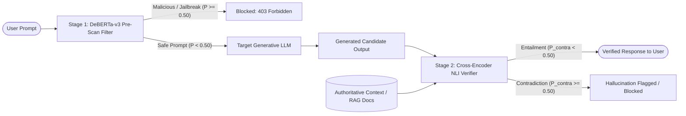

# GuardShield AI

[](https://opensource.org/licenses/Apache-2.0)
[](https://www.python.org/downloads/)
[](https://pytorch.org/)
[](https://huggingface.co/)
[](https://colab.research.google.com/github/Shourya3113/GuardShield-AI/blob/main/GuardShield_AI_Live_Colab_Suite.ipynb)

> **Real-Time Dual-Stage Pre-Scan Defense and Fact Grounding Architecture for Large Language Models**  
> *Capstone Research Project | Group 50 | Academic Year 2026*

---

## 📌 Executive Summary

Modern Large Language Models (LLMs) deployed in production environments face two critical, compounding vulnerability vectors:
1. **Adversarial Ingress**: Prompt injections, role-play jailbreaks, and obfuscated exploits that bypass system prompts to compromise model alignment.
2. **Hallucinatory Egress**: Fabricated assertions, unsupported extrapolations, and factual inconsistencies generated during open-ended decoding.

**GuardShield AI** provides a synchronous dual-stage defense pipeline combining:
- **Stage 1 (Pre-Scan Filter)**: A lightweight, fine-tuned transformer classifier (`microsoft/deberta-v3-small`: 44M backbone, ~142M total parameters including the 128k SentencePiece vocabulary) that inspects ingress prompts in **~10.98 ms**, blocking injections, jailbreaks, and length-padded attacks before they consume expensive downstream LLM decoding passes.
- **Stage 2 (Post-Generation Fact Grounding)**: A cross-encoder Natural Language Inference (NLI) verifier (`cross-encoder/nli-deberta-v3-small`) that performs premise-hypothesis entailment verification (**~20.47 ms**) to validate LLM assertions against authoritative retrieval context in RAG architectures.



---

## 📊 V3 Mega Research Benchmark Evaluation (5,948 Curated Samples)

GuardShield AI has been empirically evaluated across **7 published academic and industry benchmark datasets**:
- **Security & Adversarial Benchmarks (5,148 samples)**:
  - *In-Distribution (4,648 samples)*: Partitioned into 3,253 Train, 697 Validation, and 698 Test samples across Stanford Online Safety (SPML), Jayavibhav Injection Suite, and Deepset Prompt Injections.
  - *Out-of-Distribution Zero-Shot (500 samples)*: 250 novel ChatGPT JailbreakBench attacks + 250 held-out benign queries.
- **Factuality & Hallucination Grounding Benchmarks (800 unique pairs)**:
  - 400 unique claim-evidence pairs from **FEVER (NAACL 2018)** (200 Supported, 200 Refuted).
  - 400 unique grounded-hallucinated QA pairs from **HaluEval (EMNLP 2023)** (200 Grounded, 200 Hallucinated).

### Empirical Evaluation Summary

| Defense Component | Evaluation Dataset / Split | Sample Size ($N$) | Accuracy (%) | Precision (%) | Recall (%) | F1-Score | FPR (%) | Mean Latency (ms) |
| :--- | :--- | :---: | :---: | :---: | :---: | :---: | :---: | :---: |
| **Stage 1: Pre-Scan** | **In-Distribution Test Split** | **698** | **98.57%** | **99.43%** | **97.75%** | **0.9858** | **0.58%** | **10.98 ms** |
| **Stage 1: Pre-Scan** | **Out-of-Distribution Zero-Shot** | **500** | **98.20%** | **99.18%** | **97.20%** | **0.9818** | **0.80%** | **21.24 ms** |
| **Stage 2: Fact Verifier** | **Multi-Source Fact Grounding (FEVER + HaluEval)** | **800** | **76.38%** | **90.11%** | **59.25%** | **0.7149** | **6.50%** | **20.47 ms** |
| **Dual-Stage Pipeline** | **Empirical Combined Overhead** | — | — | — | — | — | — | **~31.45 ms** |

*Note: Stage 1 metrics reflect pure neural inference without keyword-based heuristics. Stage 2 evaluates cross-encoder contradiction classification ($p_{\text{contradiction}} \ge 0.50$) across 800 unique, non-duplicated academic benchmark pairs.*

---

### Comparative Baseline: Transformer vs. Bag-of-Words (TF-IDF + Logistic Regression)

To assess whether the transformer representation provides genuine advantages over surface lexical features, we benchmarked a standard TF-IDF + Logistic Regression model against GuardShield on identical splits:

| Model Architecture | In-Distribution Accuracy | In-Distribution Recall | OOD Zero-Shot Accuracy | OOD Zero-Shot Recall | Generalization Delta |
| :--- | :---: | :---: | :---: | :---: | :---: |
| **TF-IDF + Logistic Regression (Baseline)** | 94.56% | 91.55% | 80.00% | 62.40% | **-29.15% Recall Collapse** |
| **GuardShield DeBERTa-v3 (Ours)** | **98.57%** | **97.75%** | **98.20%** | **97.20%** | **-0.55% Robust Generalization** |

**Key Finding**: While bag-of-words classifiers detect familiar keyword patterns on in-distribution data, they suffer a severe **29.15 percentage point drop in attack recall** when confronted with unseen zero-shot jailbreak templates. GuardShield's contextual transformer maintains **97.20% recall** out-of-distribution with a minimal false positive rate of **0.80%**.

---

## 🚀 Live Interactive Colab Suite

Experience GuardShield AI directly in Google Colab with free T4 GPU acceleration:  
👉 [](https://colab.research.google.com/github/Shourya3113/GuardShield-AI/blob/main/GuardShield_AI_Live_Colab_Suite.ipynb)

The Colab suite includes 6 interactive modules:
1. **Environment Setup & GPU Telemetry**: Diagnostic verification of CUDA environment and PyTorch acceleration.
2. **Generative LLM Engine Selection**: Load and run test prompts through generative backbones including `Qwen/Qwen2.5-3B-Instruct`, `TinyLlama/TinyLlama-1.1B-Chat`, `microsoft/Phi-3.5-mini-instruct`, or `gpt2`.
3. **Stage 1 Neural Pre-Scan Filter**: Live prompt inspection and full in-distribution test-set evaluation without keyword overrides.
4. **Streaming Token Entropy Telemetry**: Real-time per-step token uncertainty profiling $H(x) = -\sum_{i=1}^k p_i \log_2(p_i)$ with automatic early-termination thresholding.
5. **Analytical Compute Savings Benchmark**: Analytical hardware profiling illustrating 94%–99.4% latency avoidance and 100% downstream decoding cost avoidance when intercepting attacks at Stage 1 before heavy 3B/7B autoregressive decoding passes.
6. **Stage 2 Fact Grounding & Interactive Defense Sandbox**: Live premise-hypothesis NLI verification and a unified sandbox for arbitrary user prompts.

---

## 📁 Repository Structure

```text
GuardShield_AI/
├── data/
│   ├── mega_research_datasets/   # Aggregated 5,148-sample security and 800 factuality benchmarks
│   ├── processed/splits_v3/       # Partitioned Train (3,253), Val (697), Test (698), OOD (500), and Fact (800)
│   ├── published_paper_datasets/  # Standardized benchmark CSVs from ACL, NAACL, EMNLP literature
│   └── raw/                       # Original ingested corpus samples
├── docs/
│   ├── 01 Reports/                # Academic progress reports, presentations, and confusion matrices
│   ├── 02 Weekly WPRs/            # Formal Weekly Progress Reports (WPR 1 through WPR 9)
│   ├── 03 Research and Catalogs/  # LaTeX tables, dataset catalogs, and research gap formulation
│   └── 04 Diagrams/               # System architecture and WBS diagrams
├── models/
│   ├── deberta_v3_prescan_v3/     # Fine-tuned Stage 1 model configs and evaluation summaries
│   └── README.md                  # Model weights reproduction and download guide
├── scripts/
│   ├── build_live_colab_suite.py  # Script generating the interactive Colab notebook
│   ├── build_wpr9.py              # Automated WPR document generation script
│   └── export_mega_datasets.py    # Master dataset export and validation utilities
├── src/
│   ├── config.py                  # Centralized path and hyperparameter configuration
│   ├── demo_master.py             # CLI demonstration suite for all pipeline components
│   ├── evaluate_full_suite_v3.py  # Pure neural benchmark test suite across in-dist, OOD, and factuality
│   ├── nli_verifier.py            # Stage 2 cross-encoder NLI entailment verifier
│   ├── prepare_splits_v3_mega.py  # V3 mega benchmark dataset partitioning pipeline
│   ├── prescan_filter.py          # Stage 1 real-time classification engine with sliding-window chunking
│   ├── proxy_server.py            # FastAPI sidecar proxy with modern lifespan management
│   ├── streaming_entropy_engine.py# Real-time token entropy calculation and spike detection
│   └── train_prescan_v3.py        # Stage 1 DeBERTa-v3-small GPU training script
├── GuardShield_AI_Live_Colab_Suite.ipynb  # Interactive Google Colab demonstration notebook
├── requirements.txt                       # Python project dependencies
├── LICENSE                                # Apache 2.0 Open Source License
└── README.md                              # Main project documentation
```

---

## 🛠️ Quickstart & Local Setup

### 1. Prerequisites & Installation
Ensure you have Python 3.10+ and a CUDA-compatible GPU (recommended):

```bash
git clone https://github.com/Shourya3113/GuardShield-AI.git
cd GuardShield-AI
pip install -r requirements.txt
```

### 2. Run the Full V3 Benchmark Suite
Evaluate both Stage 1 and Stage 2 across in-distribution test sets, zero-shot out-of-distribution attacks, and factuality benchmarks:

```bash
python src/evaluate_full_suite_v3.py
```

### 3. Run the Sidecar Proxy Server
Launch the FastAPI sidecar proxy on `http://127.0.0.1:8000`:

```bash
python src/proxy_server.py
```

### 4. Interactive Command-Line Demonstration
Test custom prompts against the dual-stage defense in real-time:

```bash
python src/demo_master.py
```

---

## 📈 Weekly Project Progression

| Week | Phase / Milestone | Status | Key Deliverable |
| :---: | :--- | :---: | :--- |
| **W1** | Problem Statement & System Architecture Definition | ✅ Completed | WPR 1, Project Proposal, Baseline Design |
| **W2** | Literature Survey & Threat Model Characterization | ✅ Completed | WPR 2, Published Datasets Catalog |
| **W3** | Data Ingestion & Obfuscation Attack Synthesis | ✅ Completed | WPR 3, Processed Train/Val/Test Splits |
| **W4** | Stage 1 Model Training (`deberta-v3-small`) | ✅ Completed | WPR 4, Initial Pre-Scan Classifier |
| **W5** | Stage 2 Cross-Encoder NLI Verifier Integration | ✅ Completed | WPR 5, Premise-Hypothesis Pipeline |
| **W6** | Dual-Stage Pipeline Integration & Streaming Proxy | ✅ Completed | WPR 6, End-to-End Orchestrator |
| **W7** | Multi-Dataset Benchmarking (Stanford, Jayavibhav, Deepset) | ✅ Completed | WPR 7, 2,166-Sample Comparative Study |
| **W8** | Publication Preparation & Formal Research Catalogs | ✅ Completed | WPR 8, IEEE/ACM Ready LaTeX Tables |
| **W9** | V3 Mega Benchmark Scaling (5,948 Samples) & Colab Live Suite | ✅ Completed | WPR 9, 98.57% In-Dist Acc, 98.20% OOD Acc |

---

## 📚 Datasets & Attribution

GuardShield AI evaluates against open research datasets curated from the academic community:
- **Stanford Online Safety (SPML)**: [Stanford Safety Prompts](https://huggingface.co/datasets/stanford-crfm/spml) (CC-BY-4.0)
- **ChatGPT JailbreakBench**: [JailbreakBench](https://github.com/JailbreakBench/jailbreakbench) (MIT)
- **Deepset Prompt Injections**: [deepset/prompt-injections](https://huggingface.co/datasets/deepset/prompt-injections) (Apache-2.0)
- **FEVER Fact Extraction & VERification**: Thorne et al., NAACL 2018 (CC-BY-SA 3.0)
- **HaluEval Hallucination Benchmark**: Wang et al., EMNLP 2023 (MIT)
- **TruthfulQA**: Lin et al., ACL 2022 (Apache-2.0)

---

## 👥 Research Team & Affiliation

**Capstone Project Group 50 | B.Tech Computer Science & Engineering**

- **Shourya Solanki** (Lead Architect — Pipeline Implementation, Model Training & Benchmarking)
- **Dhruv Sharma** (Data Engineer — Ingestion, Preprocessing & Corpus Curation)
- **Rachit Garg** (Research Analyst — Literature Survey, Gap Formulation & Verification)
- **Faculty Guide**: Dr. Abhishek Kaushik

---

## 📄 License

This repository is licensed under the [Apache License 2.0](LICENSE).
